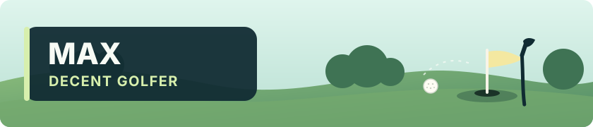

# Hi, I’m Max

I play golf.

## Featured project
[Volunteer Hour Record](<https://github.com/max107sha110/Volunteer-Hours-Record>)

I used copilot and supabase for login to make a record-tracking app for an NPO (projects can be used for other orgs).

## Related experience
I learnt coding with cs50 and with the help of Dr. [Martin Pieters](https://djmpinstitute.org/#builders). In middle school, I was the top scorer in LAUSD and 2nd in online nationals.

## What I’m learning next
Using AI to analyze the mechanics of a golf swing.

## My toolbox

 

 · [See commit history](https://github.com/max107sha110/my-third-repo/commits)

